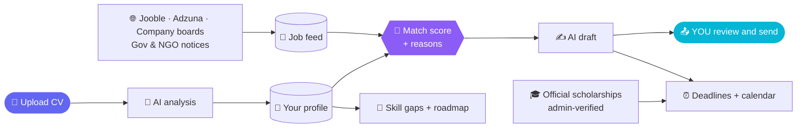

<div align="center">



<a href="https://careerpilot-ai-bd.vercel.app">
  
</a>

<br/>

<a href="https://careerpilot-ai-bd.vercel.app"></a>


<br/><br/>

> ### 🛡️ Our promise: **no auto-apply, no auto-email.**
> CareerPilot AI only **drafts**. You read it, edit it, and send it yourself.

</div>

---

## ✨ What it does

<table>
<tr>
<td width="50%" valign="top">

### 📄 Smart CV analysis
Upload a CV in **English or Bengali**, from **any field**. The AI reads your skills, education, projects and experience and builds your profile.

### 🎯 Explainable job matching
Every job gets a **match score with reasons**: skills you have, skills you miss, and why it fits (or doesn't).

### 🇧🇩 Built for Bangladesh
**All job types inside Bangladesh** (private, government, NGO) and **only remote jobs from outside**. Government notice reader included.

</td>
<td width="50%" valign="top">

### 🎓 Scholarships
HSC, Bachelor's, Master's and PhD. **Official links only**, grouped by country, with details, save, and a scam warning. Every entry is checked by an admin before users see it.

### ✍️ Application workspace
Track every application and let AI **draft** cover letters and emails (English or Bengali). Edit, copy, send yourself.

### ⏰ Deadlines & reminders
One page for all deadlines, plus a **calendar file (.ics)** that reminds you 7 days and 1 day before.

</td>
</tr>
<tr>
<td width="50%" valign="top">

### 🧭 Skill gaps & learning roadmap
See which skills block your target jobs and get a step-by-step roadmap to close the gap.

### 🔒 Privacy first
Download all your data, delete your account, and nothing is shared. Error logs hold no personal details.

</td>
<td width="50%" valign="top">

### 🧰 Powerful admin panel
Pick **any AI provider** (free or paid) and paste its key: it is stored **encrypted** and powers the whole site. Manage users, jobs, job sources, scholarships, usage and errors.

### 🧹 Self-cleaning feed
Closed jobs are hidden, old ones removed, duplicate jobs merged, and scholarship pages re-checked every week.

</td>
</tr>
</table>

---

## 🧠 How it works



---

## 🧱 Tech stack

<div align="center">


</div>

| Layer | Choice |
|---|---|
| App | Next.js 16 (App Router), React 19, TypeScript (strict) |
| UI / 3D | Tailwind CSS 4, React Three Fiber |
| Auth | Better Auth (email + password, optional email verification) |
| Database | Neon Postgres + Drizzle ORM (migrations in `drizzle/`) |
| AI | Provider-agnostic layer (OpenAI-compatible, Anthropic, Gemini, Groq and more), keys encrypted with AES-GCM |
| Hosting | Vercel (daily job refresh and weekly scholarship check via cron) |

---

## 👥 Team & contributions

<div align="center">

<table>
<tr>
<td align="center" width="360" valign="top">
<a href="https://github.com/Nayeem131136"></a>
<h3>Md. Mahdi Hasan Nayeem</h3>

<p><sub>Foundation · Auth · Admin AI · CV analysis<br/>Job feed · Scholarships · Deadlines · Monitoring</sub></p>
<a href="https://github.com/Nayeem131136"></a>
</td>
<td align="center" width="360" valign="top">
<a href="https://github.com/tandra136131"></a>
<h3>Rupasha Khan Tandra</h3>

<p><sub>AI job matching · Application tracker · AI drafts<br/>Skills roadmap · Admin tools · Jobs feed rules</sub></p>
<a href="https://github.com/tandra136131"></a>
</td>
</tr>
</table>

</div>

| Member | Role | What they built | Commits | Lines (added / removed) |
|---|---|---|:-:|:-:|
| [**Md. Mahdi Hasan Nayeem**](https://github.com/Nayeem131136) | Lead Developer, Core Platform | • Project setup: Next.js 16, TypeScript, Tailwind 4, design system, 3D landing page, public pages<br/>• Authentication, database schema and Neon / Vercel deployment<br/>• Admin AI Control Center (any AI provider, encrypted key, model loading)<br/>• Onboarding and CV analysis, including projects<br/>• Job feed, Bangladesh filters and government notice reader<br/>• Security hardening, Privacy and Terms, error pages, account export and delete, SEO<br/>• Speed pass: cached auth lookups and faster job queries<br/>• Scholarships: admin review queue, paste-and-fill form, bulk import, weekly link check<br/>• Deadlines page and calendar reminders, closed-job hiding<br/>• Built-in error monitoring and admin Errors page | 18 | +40,669 / −505 |
| [**Rupasha Khan Tandra**](https://github.com/tandra136131) | AI Features, Applications and Admin | • AI match score and explanations for every job<br/>• Application tracker and AI draft writer (English and Bengali)<br/>• Skill gaps and AI learning roadmap<br/>• Admin tools: users, jobs and statistics<br/>• Jobs feed rule: all jobs in Bangladesh, only remote elsewhere<br/>• Jooble search that always includes Bangladesh<br/>• Jobs filter layout fix | 7 | +10,331 / −100 |
| **Total** | | | **23** | **+50,290 / −605** |

<sub>Counted from the commits in this repository on 13 Nov 2026. Nayeem's 16 commits include one automatic merge commit.</sub>

<div align="center">


</div>

<details>
<summary><b>🧑‍💻 Md. Mahdi Hasan Nayeem: everything he built (16 commits)</b></summary>

- **Project setup and foundation:** Next.js 16 and TypeScript project, Tailwind 4, design system, animated 3D landing page, public pages (features, how it works, pricing, about, contact)
- **Authentication and database:** sign up and sign in, roles, Drizzle schema, Neon Postgres, Vercel deployment
- **Admin AI Control Center:** choose any AI provider (free or paid), encrypted key storage, load available models, connection test
- **Onboarding and CV analysis:** CV upload (English and Bengali), AI profile extraction, projects section
- **Job feed:** job sources, Bangladesh filters, government notice reader, save and hide jobs
- **Security, privacy and polish:** security headers, Privacy and Terms pages, error and 404 pages, account data export and delete, robots and sitemap, final testing
- **Speed:** cached auth lookups, lighter job queries, parallel queries
- **Scholarships:** official-link list, admin review queue, paste-and-fill form, bulk import, weekly link re-check
- **Deadlines:** deadlines page, own deadline per application, calendar reminders (.ics)
- **Closed jobs:** hide expired jobs, "closing soon" tag, auto-clean old closed jobs
- **Error monitoring:** built-in error log and admin Errors page
- Merge of the team's work into `main`

</details>

<details>
<summary><b>👩‍💻 Rupasha Khan Tandra: everything she built (7 commits)</b></summary>

- **AI match score and explanations:** a score for every job with the reasons, skills you have and skills you miss
- **Application tracker and AI draft writer:** track each application, AI drafts cover letters and emails in English or Bengali
- **Skill gaps and AI learning roadmap:** shows missing skills and builds a step-by-step plan
- **Admin tools:** users, jobs and statistics pages
- **Jobs feed rule:** all jobs inside Bangladesh, only remote jobs from elsewhere
- **Jooble:** every refresh also searches Bangladesh
- **Jobs filter layout fix**

</details>

---

## 🚀 Quick start

```bash
git clone https://github.com/Nayeem131136/careerpilot-ai-bd.git
cd careerpilot-ai-bd
npm install
cp .env.example .env.local     # without DATABASE_URL an embedded local Postgres is used
npm run dev                    # http://localhost:3000
```

Production database (Neon): `npm run db:migrate`, then deploy to Vercel. Step by step: **[DEPLOY.md](DEPLOY.md)**.

<details>
<summary><b>🔑 Environment variables</b></summary>

| Variable | Required | Purpose |
|---|:-:|---|
| `DATABASE_URL` | ✅ | Neon / Postgres connection string |
| `BETTER_AUTH_SECRET` | ✅ | Session signing secret |
| `MASTER_ENCRYPTION_SECRET` | ✅ | Encrypts the AI provider key stored by the admin |
| `NEXT_PUBLIC_APP_URL` | ✅ | Public site URL |
| `ADMIN_EMAILS` | ✅ | Comma-separated emails that become admins |
| `JOOBLE_API_KEY` | ➖ | Bangladesh and worldwide jobs |
| `ADZUNA_APP_ID`, `ADZUNA_APP_KEY` | ➖ | More job results |
| `CRON_SECRET` | ➖ | Protects the daily and weekly cron routes |
| `RESEND_API_KEY`, `EMAIL_FROM` | ➖ | Email verification and password reset |
| `LEGAL_OWNER_NAME`, `LEGAL_COUNTRY`, `LEGAL_CONTACT_EMAIL` | ➖ | Shown in Privacy and Terms |

The AI provider and its key are **not** environment variables: the admin adds them in `/admin/ai`.

</details>

<details>
<summary><b>🛠️ Scripts</b></summary>

`npm run dev` · `npm run build` · `npm run typecheck` · `npm run lint` · `npm run db:generate` · `npm run db:migrate` · `npm run db:studio`

</details>

---

## 🔐 Security highlights

- Every record is scoped to its owner; admin actions re-check the role on the server
- Same-origin checks on all mutating API routes, per-user daily AI limits
- AI prompts fence untrusted CV and job text and validate JSON output
- SSRF-safe page fetching that respects `robots.txt`
- AI keys encrypted at rest; security headers and CSP enabled
- Suspended accounts are blocked on every request

---

## 🗺️ Roadmap

- [x] CV analysis, explainable matching, application drafts
- [x] Bangladesh job feed, notice reader, admin tools
- [x] Scholarships, deadlines and calendar reminders, error monitoring
- [ ] Email deadline reminders
- [ ] Scholarship fit checklist from your CV
- [ ] Premium plan with local payments (bKash / Nagad)
- [ ] More Bangladesh job sources

---

## 📚 Docs

| File | What is inside |
|---|---|
| [`DEPLOY.md`](DEPLOY.md) | Deploy to Vercel and run migrations, step by step |
| [`docs/ARCHITECTURE.md`](docs/ARCHITECTURE.md) | Structure and design decisions |
| [`docs/PROGRESS.md`](docs/PROGRESS.md) | What is done and what comes next |
| [`docs/SPEC.md`](docs/SPEC.md) | Full product spec |

---

<div align="center">

**Built with 💜 in Bangladesh**

<sub>Developed with AI assistance (Claude by Anthropic) for code generation. The team directed, reviewed, tested and deployed the project.</sub>


</div>
